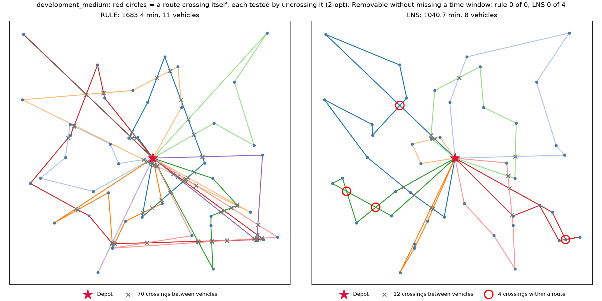
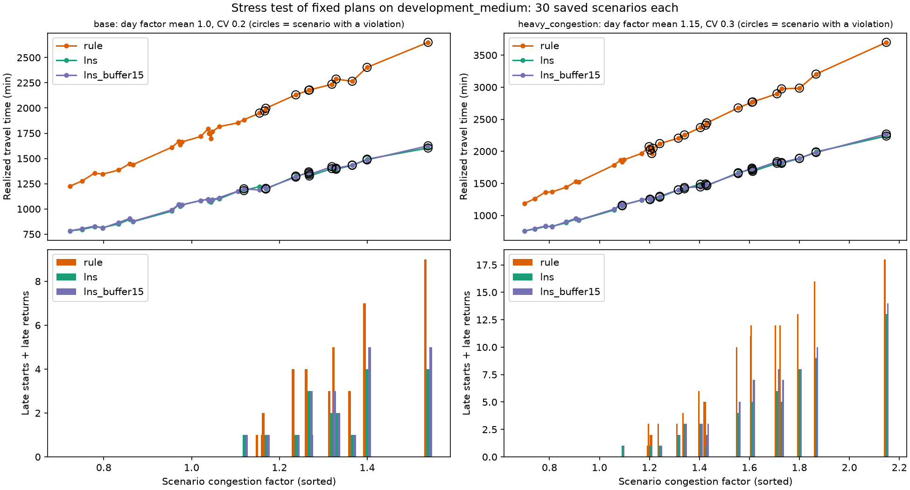

# OM 522 Option 3: Delivery Route Planner

> **TEAM: rewrite this paragraph in your own words before submitting (the guide requires it).**
> Every day a dispatcher at a distributor decides which delivery vehicle serves each customer and
> in what order the stops are made. Each vehicle leaves the single depot at the start of its shift,
> carries a limited load, and must be back by the end of the shift, and each customer only accepts a
> delivery whose service starts inside its time window. This tool reads the day's customer, vehicle,
> and travel-time files, plans the routes, and reports the total travel time, the number of vehicles
> used, and the waiting and service consequences. Assumptions added beyond the brief: none. Unused
> vehicles cost nothing, and the plan minimizes travel time only (vehicles used is reported as the
> secondary measure, not optimized).

## Where is everything?

```
om522-vrptw/
├── src/vrptw/         ★ THE CODE: the route planner itself (start here)
│   ├── rule.py            Method 1: the rule to beat
│   ├── lns.py             Method 2: the researched method (large neighborhood search)
│   ├── checker.py         Independent checker: verifies any plan from scratch
│   ├── instance.py        Reads the input CSVs and runs the 4 input checks
│   ├── decision.py        Writes decision.json and summary.json
│   ├── cli.py             The "pixi run solve" command that ties the above together
│   ├── stress.py          Stress test (30 traffic scenarios)
│   └── crossings.py       Extra: where routes cross on the map
├── tests/             Automated tests            → pixi run test
├── scripts/           Builds every result table/plot → pixi run compare
│                      (also prototype_demo.py       → pixi run prototype-demo)
├── notebooks/         Interactive screens (video walkthrough) → pixi run walkthrough
├── results/           Output of pixi run compare (start with RESULTS.md)
├── data/option_03/    Input data from the instructor (never edited)
├── docs/              Prototype recording guide and the note on what Codex changed
├── presentation/      Prototype slide deck and speaker notes (start with START_HERE.md)
├── review/            The independent code review whose findings were all fixed
├── AGENT_LOG.md       Parts the AI drafted, what was wrong, and how we checked them
├── pixi.toml          The list of commands and packages (pixi.lock pins exact versions)
└── README.md          This file
```

Each folder has its own short `README.md` explaining its files. `src/vrptw/README.md` also gives
the order to read the code in.

| I want to... | Look at |
|---|---|
| See how the rule to beat works | `src/vrptw/rule.py` (46 lines) |
| See how the researched method works | `src/vrptw/lns.py`, guided by `src/vrptw/README.md` |
| See how a plan is checked | `src/vrptw/checker.py` |
| See what makes input "malformed" | `load_instance` in `src/vrptw/instance.py` |
| See the three required tests | `tests/test_required.py` (the first three tests in `tests/README.md`) |
| See the results | `results/RESULTS.md`, or the Results section below |
| Pick a component for the video walk-through | `AGENT_LOG.md`, and the suggested split in `docs/PROTOTYPE_GUIDE.md` |
| Plan the prototype recording | `presentation/START_HERE.md`, then `docs/PROTOTYPE_GUIDE.md` |
| Add or change a `pixi run ...` command | `pixi.toml`, under `[tasks]` |

## Quick start

```bash
pixi install                                                    # build the environment from pixi.lock
pixi run test                                                   # run all automated tests
pixi run solve data/option_03/development_medium out/medium     # researched method (default settings)
pixi run solve data/option_03/hand_checkable out/hand --method rule   # rule to beat
pixi run check data/option_03/development_medium out/medium/decision.json   # independent checker
pixi run compare                                                # regenerate every table and plot in results/
pixi run explore                                                # optional marimo interface
pixi run walkthrough                                            # the screen we record the videos from
pixi run prototype-demo                                         # prototype recording: fresh copy, both methods, checker, comparison
pixi run prototype-demo --checks-only                           # rehearsal: malformed inputs, edge case, worked example, tests
```

`prototype-demo` writes only under `out/prototype_demo/` and never changes the supplied inputs or
`results/`. [docs/PROTOTYPE_GUIDE.md](docs/PROTOTYPE_GUIDE.md) explains how to use it in the recording.

`solve` takes an input directory and an output directory. It writes `decision.json` (the structure of
`worked-example/solution.json`) and `summary.json` (run status, seed, stopping reason, runtime, and the measures: total travel time,
vehicles used, waiting time, service time, route duration, and customers served).

| Input | Behavior |
|---|---|
| Malformed (missing file or column, wrong type, empty value, unknown id, non-positive service time) | Prints `Input error: <file>: column '<column>' ...`, writes no decision.json, exits with status 2 |
| Valid, no feasible plan found | Prints `no feasible decision found`, writes no decision.json, exits with status 0 |
| Valid | Writes decision.json and summary.json, exits with status 0 |
| Output directory equal to the input directory, or not a directory | Prints `Output error: ...`, exits with status 2 (inputs are never modified) |

Every run first deletes any `decision.json` and `summary.json` left in the output directory by an
earlier run (and touches nothing else), so a malformed or infeasible run can never leave an old
decision behind. Both files are written to a temporary name and then renamed, `decision.json` last.

Options: `--method lns|rule`, `--seed` (default 522), `--iterations` (default 8000, zero or more),
`--restarts` (independent runs, default 1, at least 1), and `--time-cap` (safety cap in seconds,
default 480, finite and zero or more). Invalid settings are rejected with exit status 2.

## Method 1: rule to beat (nearest feasible neighbor)

Implemented exactly as the brief states (`src/vrptw/rule.py`).
- **Representation:** one ordered list of customers per vehicle.
- **Construction:** vehicles are taken in identifier order, and each leaves the depot at its shift start. The vehicle repeatedly moves to the nearest unserved customer by travel time from its current location (ties by customer id) that fits the remaining capacity, can start service by its window end, and still allows a return by the shift end.
- **Stopping rule:** a vehicle stops when no customer qualifies. The method stops when all customers are served or all vehicles are used, reporting "no feasible decision found" in the second case.
- **Randomization:** none (deterministic).
- **Limitations:** it is myopic. It ignores waiting time and fills vehicles one at a time, so the last vehicles collect scattered leftovers.
- **Check:** reproduces the worked example exactly (total travel 352.417, 2 vehicles, waiting 232.861).

## Method 2: large neighborhood search (researched method)

**Source:** Ropke, S., & Pisinger, D. (2006). An adaptive large neighborhood search heuristic for
the pickup and delivery problem with time windows. *Transportation Science*, 40(4), 455–472.
Supporting sources: Bräysy, O., & Gendreau, M. (2005), Vehicle routing problem with time windows,
Part I: Route construction and local search algorithms, *Transportation Science*, 39(1), 104–118
(local search moves); Savelsbergh, M. W. P. (1992), *ORSA Journal on Computing*, 4(2), 146–154
(constant-time time-window checks); Shaw, P. (1998), CP-98 (related removal); Solomon, M. M. (1987),
*Operations Research*, 35(2), 254–265 (insertion heuristics with time windows).

**Why it fits this decision.** Time windows are narrow (about 90 of 600 minutes), so most simple
moves are infeasible and a plain improvement search gets stuck quickly. LNS removes a group of
related customers (close in travel time and in window timing) and reinserts them all at once, which
can reorganize several routes in one step. Regret insertion places the hardest-to-fit customers
first, which matters when windows leave few feasible positions.

- **Representation:** one ordered list of customers per vehicle (empty = unused). Each route caches its departure time at every stop and the latest feasible service start at every stop, so a proposed insertion is checked in constant time.
- **Construction:** two starting plans are built and each is improved by local search: (a) regret-2 insertion, which builds all routes in parallel, and (b) the rule-to-beat plan. The better one is kept, so the method never returns a plan worse than the rule.
- **Improvement (local search):** variable neighborhood descent with five moves: 2-opt (reverse a segment within a route, the class's subsequence reversal), or-opt (move 1–3 consecutive customers within a route), relocate (move a customer to another route), swap (exchange customers between routes), and 2-opt* (exchange the tails of two routes). A move is applied only if it shortens total travel time **and** every changed route passes a full capacity, window, and shift check. The search restarts from the first move after every improvement and stops when no move improves.
- **Ruin and recreate:** each iteration removes q customers (2 ≤ q ≤ min(15, n/4)) using random removal (30%), related removal (40%), or worst-detour removal (30%). It reinserts them with regret-2 or regret-3 insertion, then runs the local search. The result is accepted if it is shorter, or, with simulated-annealing probability exp(−Δ/T), if it is longer. The starting temperature is set so that a plan 0.5% worse than the start is accepted with probability 0.5 (the Ropke & Pisinger rule), and T falls linearly to 0. The best plan seen is kept. The 0.5% was tuned on development_small, development_medium, and five 60-customer subsets of development_large. A much colder setting got stuck: every seed and budget returned the same 1047.6 on medium.
- **Feasibility guarantee:** every plan the search keeps, current or best, passes a full capacity, window, and shift check. Removing customers can, in principle, make a shortened route late when travel times break the triangle inequality, because a detour through a removed customer can be faster than the direct leg. Such a trial is discarded, and changed routes are re-checked before any acceptance. On the supplied data this never triggered (0 of 60,000 random removals), but it makes the guarantee unconditional.
- **Stopping rule:** 8000 ruin-and-recreate iterations. The 480 s wall-clock cap is a safety net only. It is checked inside construction, repair, and local search as well, and when it fires the best feasible plan found so far is returned. `summary.json` reports `stop_reason`, `time_cap_seconds`, the iterations actually run, and the elapsed time. Optional `--restarts R` runs R independent searches and keeps the best. On the same total budget this gave no reliable gain, so the default is 1.
- **Randomization and seed:** one `random.Random(522)` created once per run (run r of a restart series uses 522 + r). The same input and settings always give the same routes (tested).
- **Limitations:** a heuristic, with optimality proven only where the Gurobi benchmark could prove it. Operator weights are fixed, not adaptive. Travel time is the only objective, so it does not trade travel for robustness (see the stress test). Pure Python, single thread. For asymmetric travel tables, 2-opt switches to an exact (slower) cost comparison.

## Results

All numbers come from `pixi run compare`. `results/RESULTS.md` holds the full tables.

Machine: Windows 11 laptop (Intel Core, 12th gen), Python 3.12, pure Python, single thread. Default
LNS settings throughout (seed 522, 8000 iterations, 480 s safety cap; no run reached the cap).

### Deterministic comparison (both decisions verified by the independent checker)

| Instance | Customers | Rule travel (min) | LNS travel (min) | Travel saved | Rule vehicles | LNS vehicles | LNS seconds |
|---|---|---|---|---|---|---|---|
| hand_checkable | 6 | 352.42 | 329.67 | 6.5% | 2 | 2 | 0.5 |
| development_small | 15 | 620.58 | 459.09 | 26.0% | 5 | 4 | 1.0 |
| development_medium | 45 | 1,683.40 | 1,040.68 | 38.2% | 11 | 8 | 8.9 |
| development_large | 120 | 3,523.22 | 2,135.61 | 39.4% | 25 | 19 | 27.8 |
| edge_case | 10 | no feasible decision found | no feasible decision found | | | | |

The rule runs in under 3 milliseconds on every instance. **How results change with size:** the LNS advantage grows from
6.5% on 6 customers to about 38–39% at 45 and 120 customers. With few customers there is little room
to recombine routes, while the rule's one-vehicle-at-a-time greed gets worse as more leftovers
accumulate for the last vehicles. LNS runtime grows roughly in proportion to size (about 9 s at 45 customers, 16–17 s
at 60, and 28 s at 120 in the latest run) and stays far below the 10-minute limit. Runtimes on this
laptop vary by up to about 50% between runs depending on other load (other runs measured 6 to 11 s at 45
customers and 19 to 34 s at 120), so treat them as approximate; the routes and travel times are identical every run. These are single instances from one generator,
not a general claim about every delivery network. On five 60-customer subsets of
development_large (our stand-in for the held-out size, generated and solved by `pixi run compare`
into `results/proxies.csv`), the LNS beat the rule by 35.6–39.7% every time.

### Do the routes cross? (maps in `results/maps/`)

Travel times in these instances equal the straight-line distance between the plotted points (ratio
1.000–1.002), so a crossing on the map is a real crossing. A common rule of thumb says an optimal route
never crosses itself, but that holds only **without time windows**. The 2-opt move that uncrosses two
legs also reverses the order of the stops between them, and with narrow windows that new order can
make a customer late.

`pixi run compare` tests every crossing inside a route by uncrossing it and checking the result:

| Instance | Rule: crossings within a route (removable) | LNS: crossings within a route (removable) | LNS: crossings between vehicles |
|---|---|---|---|
| development_small | 1 (1 removable) | 2 (0 removable) | 0 |
| development_medium | 0 | 4 (0 removable) | 12 |
| development_large | 8 (4 removable) | 10 (0 removable) | 50 |

**No crossing left in an LNS route can be removed.** Each one would shorten travel (by 0.1 to 16.5
minutes) but make a named customer miss its window. For example, on development_medium, uncrossing
vehicle V01 would start C017 at 197.5, after its window closes at 99. The rule's plans still contain
removable crossings, a sign of an unoptimized plan. Crossings between *different* vehicles are
normal: separate trucks pass the same spot at different times. On development_medium the routes of
the Gurobi-proven optimal plan still cross 16 times. `results/crossings.csv` lists every crossing and
the reason it stays, and a test asserts that no LNS route keeps a removable crossing.



### Stress test of fixed plans (development_medium)

Uncertain input: **travel times.** Each of 30 scenarios (seed 20261008, saved to
`results/stress/*.parquet` before either plan runs) multiplies arc (i, j) by a day-level congestion
factor (lognormal, mean 1, CV 0.2) times road-level noise (lognormal, mean 1, CV 0.1, symmetric).
Each plan is executed unchanged, following the brief's rule. Every service starting after its window
end and every late return counts as a violation. The 30 sampled day factors average 1.073, so
realized travel averages about 7–8% above the deterministic values.

| Plan | Travel mean | Travel P90 | Vehicles (mean = P90) | Scenarios with a violation | Late starts | Late returns |
|---|---|---|---|---|---|---|
| Rule | 1,819.3 | 2,267.1 | 11 | 11 / 30 | 28 | 14 |
| LNS | **1,125.7** | **1,402.9** | **8** | **10 / 30** | **19** | **1** |

A harsher setting (day factor mean 1.15, CV 0.3) gives rule 18/30 vs LNS 16/30 scenarios with
violations (99 vs 56 late starts). Vehicles used is fixed by the plan, so its mean and P90 are equal.



Two follow-up checks (`results/RESULTS.md`, both regenerated by `pixi run compare`):
- **Uniform slowdown tolerance** (`results/stress/uniform_slowdown.csv`): the rule's plan breaks its
  first window when every travel time rises 16%, while the LNS plan holds until 26%. Its longer waits
  for windows act as slack.
- **Planning buffer:** an LNS plan built on travel times x 1.15 cost only 6 minutes more on normal days
  (1,046.7 vs 1,040.7) but did **not** reduce violations (10/30 scenarios). The violations come from
  individual roads running much slower than average on bad days, which a uniform buffer does not target.
  A cushion at the window end does target them (next section).

### Management scenarios: other measures of success (`results/scenarios/`)

Travel time is the graded measure, but a manager also weighs on-time reliability, driver hours, spare
room for add-on orders, and cost. `scripts/scenarios.py` (run as the last step of `pixi run compare`)
builds alternative plans for development_medium with the **same, unchanged LNS**, run on a planning
copy of the instance with tighter internal targets. Each plan is then checked by the independent
checker against the real input files and executed unchanged under the same 30 saved stress scenarios.
These are decision options, not extra graded methods.

| Plan | Planning target | Travel | Trucks | Driver hours | Smallest cushion | Days with no violation (base / heavy) | Late starts + returns (base) |
|---|---|---|---|---|---|---|---|
| Today's rule | the rule to beat | 1,683.4 | 11 | 73.9 | 8.0 min | 19 / 12 | 42 |
| Fewest miles | LNS, default | **1,040.7** | **8** | **63.8** | 4.3 min | 20 / 14 | 20 |
| 20-min cushion | every window closes 20 min early | 1,060.6 | **8** | 65.0 | 25.8 min | **27** / 18 | **4** |
| 30-min cushion | every window closes 30 min early | 1,083.1 | **8** | 64.9 | 30.9 min | **27** / 18 | 5 |
| Spare capacity | trucks loaded to at most 85% | 1,092.4 | 9 | 70.3 | 8.0 min | 26 / 20 | 7 |
| Cushion + spare | 15-min cushion and 85% loading | 1,110.2 | 10 | 78.7 | 30.9 min | **27** / **21** | **4** |

(The 10-minute cushion and full columns are in `results/scenarios/SCENARIOS.md`.) **The 20-minute
cushion costs 19.9 planned minutes (+1.9%) and no extra truck, and cuts late events on simulated days
from 20 to 4.** Two limits come from the data itself: 8 trucks is the minimum (422 units of demand,
60 per truck), and a 9-hour driver day is impossible (C039 opens at minute 500, so its truck returns
at 560.4 or later). `results/scenarios/scenario_explorer.html` is a self-contained page where a
manager sets the cost of a truck, a driver hour, a travel minute, and a late delivery and sees the
plans ranked. With example costs ($150, $30, $0.90, $75) the two LNS plans tie within $15 a day, and
the cushion wins once a late event costs more than about $101.

### Optimality check: Gurobi MIP benchmark (labeled benchmark, not a graded method)

`scripts/gurobi_benchmark.py` solves an exact two-index VRPTW mixed-integer program that we
formulated (arc variables, service-start and load variables with big-M linking constraints). Gurobi
gets the LNS plan as a MIP start. It needs a personal Gurobi license, so it runs only in the optional
environment (`pixi run -e benchmark gurobi-benchmark`) and is never part of `solve`, `test`, or `compare`.

| Instance | LNS travel (s) | Gurobi result (limit) | Lower bound | Most the LNS can exceed the optimum |
|---|---|---|---|---|
| hand_checkable | 329.67 (0.5 s) | **optimal** 329.67 (0.003 s) | 329.67 | **0%, proven optimal** |
| development_small | 459.09 (0.8 s) | **optimal** 459.09 (0.07 s) | 459.09 | **0%, proven optimal** |
| development_medium | 1,040.68 (6.4 s) | **optimal** 1,040.68 (37 s) | 1,040.68 | **0%, proven optimal** |
| development_large | 2,135.61 (21 s) | no better plan found in 30 min | 1,564.48 | 36.5% (bound still weak; true gap unknown) |

The LNS plan is **proven optimal** on every instance up to 45 customers. On 120 customers, Gurobi
found nothing better than the LNS plan in 30 minutes, about 65 times the LNS's runtime. Its lower bound
moved only from 1,563.39 (5 min) to 1,564.48 (30 min), a known weakness of big-M time-window
models, so the true gap is unknown. Read precisely: the LNS travel is at most 36.5% above the
optimum, (2,135.61 − 1,564.48) / 1,564.48, or equivalently an optimal plan could save at most 26.7% of
the LNS travel, (2,135.61 − 1,564.48) / 2,135.61. The model only prunes trips that no path can reach
in time; on all four instances this matches a direct-leg test exactly, so these results are unaffected
by the 2026-10-15 correction of that rule.

## Recommendation

**Adopt the LNS (method 2).** On a typical 45-customer day it plans about **640 fewer travel
minutes than the rule (−38%) and uses 3 fewer vehicles (8 vs 11)**. Under simulated congestion its
advantage holds: about 690 fewer minutes on average and 860 fewer at the 90th percentile, with fewer
late deliveries (19 vs 28 late starts) and almost no late returns (1 vs 14).

**Tradeoff accepted:** about 5–35 seconds of computation per plan instead of an instant answer. The
plan is a heuristic result, proven optimal only where the Gurobi benchmark could prove it (up to 45 customers). It also uses fewer, fuller vehicles, so a lost
vehicle affects more customers.

**When the recommendation would change:** if travel times on congested days routinely run more than
about **25% above the travel table** (the LNS plan's uniform tolerance), or individual roads often run
far slower than average, then *any* fixed morning plan misses windows on a large share of days. In
the heavy-congestion test the LNS still missed at least one window on 16 of 30 days. The tool would
then need to re-plan during the day from live travel times. Inflating every travel time by 15% did
not help in our tests. Planning with a 20-minute window cushion did (16 of 30 heavy days still had a
violation, down to 12), at a cost of 20 planned minutes. If late deliveries are expensive, run the LNS with that cushion
(see Management scenarios).

## Testing

`pixi run test` runs 37 tests:
1. **Required:** the rule reproduces the worked example (every visit, time, and measure).
2. **Required:** `edge_case/` gives "no feasible decision found", no decision.json, and exit 0 (both methods).
3. **Required:** a copied instance with a required column deleted is rejected with the file and column named, no decision.json, and a nonzero exit.
4. Extras: five other malformed inputs; the LNS is feasible and beats the rule on three instances; determinism; shuffled rows give the same decision; a mixed fleet with different capacities and shifts is solved and respected; the checker catches a broken decision; route duration equals travel plus waiting plus service.
5. Review regressions (`tests/test_review_fixes.py`): no infeasible plan is ever kept on non-metric travel times; a failed run clears earlier outputs; output and input directories must differ; a zero time cap still returns a feasible plan; integer overflow is an input error and integers are never rounded; nonsense settings are rejected; 2-opt works on asymmetric travel times; incomplete scenario files are rejected; crossings are detected, and no LNS route keeps a removable crossing.

## Tools and attribution

- Built with **Claude Code (Claude Opus 5.5)** for researching methods, drafting code and tests,
  profiling, and debugging. `AGENT_LOG.md` lists what was wrong in the agent drafts and how it was
  checked. **TEAM: confirm this sentence before submitting:** every component was reviewed by the team.
- **Codex** independently reviewed the project, ran algorithm experiments that were not adopted,
  and wrote `scripts/prototype_demo.py` and the guides in `docs/`. It did not change the solver,
  checker, data, or results. `docs/CODEX_CHANGES.md` lists what it added.
- An independent AI code review (Sol 6.1, `review/REVIEW_PLAN.md`) found eight issues and ten smaller
  ones. All were fixed and covered by tests (`AGENT_LOG.md`, row 10).
- No code was copied from the OM 522 in-class notebooks. The solver ideas (Nearest Neighbor, subsequence
  reversal, savings, dictionary lookups) follow the course lectures of 09-10 to 10-01.
- Data: OM 522 option 3 synthetic instances supplied by the instructor (`data/option_03/`).
- No paid service, private account, or external system is needed to run or grade the tool.
